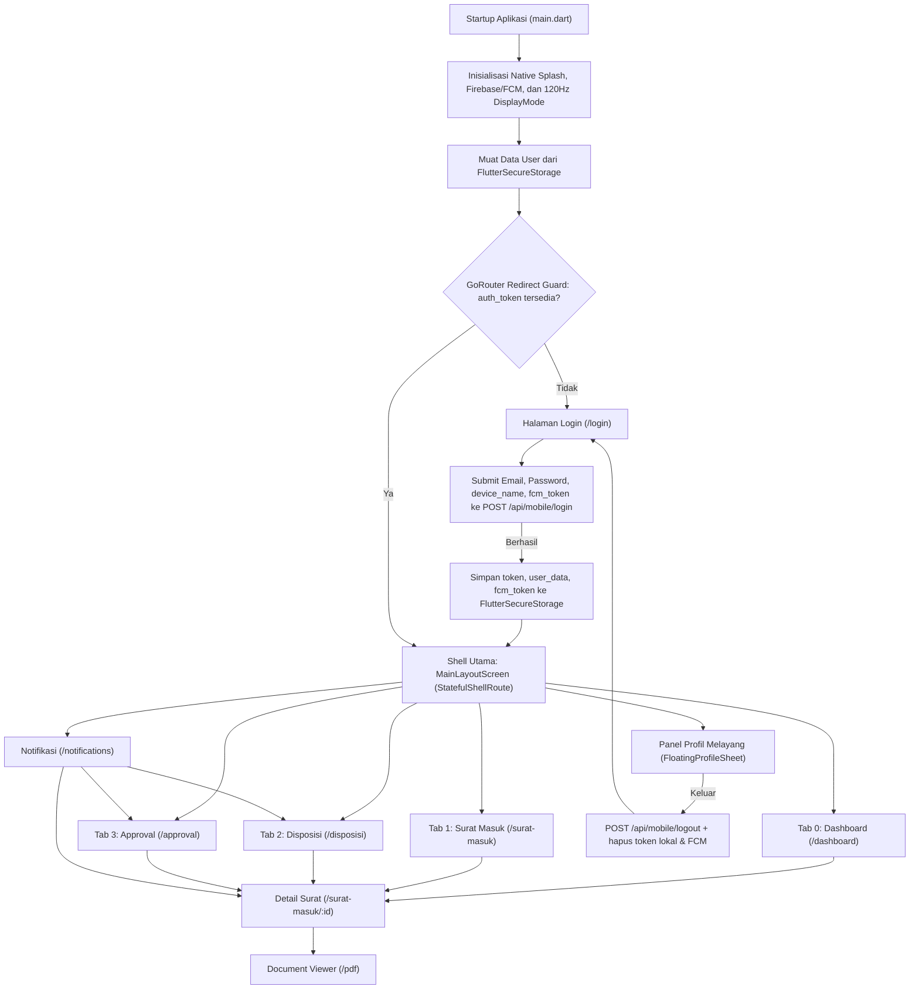
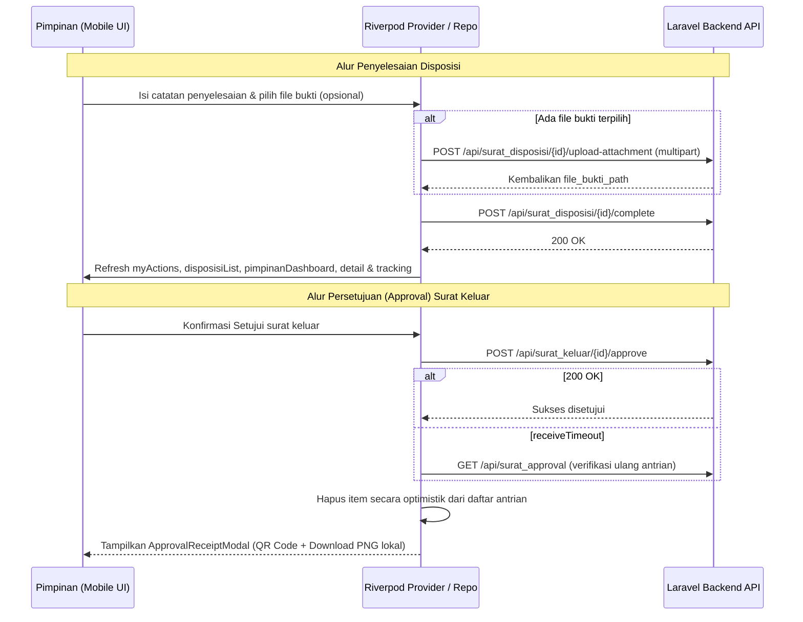

# E-Office Mobile

Aplikasi mobile resmi berbasis **Flutter** untuk ekosistem **E-Office PT ABC**, dirancang khusus sebagai **alat kerja eksekutif Pimpinan** guna memantau persuratan, menindaklanjuti disposisi, menyetujui surat keluar, melihat pratinjau dokumen lintas format, serta menerima notifikasi real-time langsung dari perangkat seluler.

> [!NOTE]
> Proyek ini merupakan bagian dari monorepo E-Office bersama [`../backend`](../backend/README.md) (Laravel 12 API + Laravel Sanctum + PostgreSQL), [`../frontend`](../frontend/) (React + Vite), dan [`../database`](../database/README.md) (PostgreSQL backup).

---

## Ringkasan Proyek

| Atribut | Nilai |
| --- | --- |
| **Nama Paket** | `e_office_mobile` |
| **Nama Tampilan** | `E-Office` |
| **Versi** | `1.0.0+1` |
| **Application ID (Android)** | `id.co.aksima.e_office_mobile` |
| **Bundle Identifier (iOS)** | `id.co.aksima.eOfficeMobile` |
| **Target Pengguna** | Grup/Role **Pimpinan** (`sys_group`) |
| **Bahasa Antarmuka** | Bahasa Indonesia |
| **Dart / Flutter SDK** | Dart `^3.12.1` (teruji pada Flutter `3.47.4` / Dart `3.13.3`) |
| **State Management & Router** | `flutter_riverpod ^2.6.1` (tanpa generator) + `go_router ^17.3.0` |
| **Backend API** | Laravel 12 + Sanctum Token Auth (`../backend`) |

---

## Daftar Isi

- [Gambaran Umum](#gambaran-umum)
- [Tujuan dan Kegunaan](#tujuan-dan-kegunaan)
- [Fitur Utama](#fitur-utama)
- [Alur Aplikasi dan Proses Bisnis](#alur-aplikasi-dan-proses-bisnis)
- [Arsitektur dan Proses Internal](#arsitektur-dan-proses-internal)
- [Struktur Direktori](#struktur-direktori)
- [Integrasi Backend API](#integrasi-backend-api)
- [Teknologi dan Dependensi](#teknologi-dan-dependensi)
- [Prasyarat dan Konfigurasi Awal](#prasyarat-dan-konfigurasi-awal)
- [Cara Menjalankan di Lokal](#cara-menjalankan-di-lokal)
- [Pengujian dan Analisis Kode](#pengujian-dan-analisis-kode)
- [Cara Build dan Rilis](#cara-build-dan-rilis)
- [Troubleshooting dan Catatan Pengembangan](#troubleshooting-dan-catatan-pengembangan)

---

## Gambaran Umum

`e_office_mobile` adalah aplikasi klien mobile yang terhubung ke REST API Laravel E-Office menggunakan autentikasi bearer token **Laravel Sanctum** (tanpa cookie atau sesi CSRF web). Seluruh endpoint eksekutif dan alur kerja pada aplikasi ini diarahkan untuk mendukung mobilitas Pimpinan agar proses persuratan tidak tertunda saat berada di luar meja kerja.

Secara desain, aplikasi menggunakan **Material 3** berbasis `flex_color_scheme` dengan warna primer teal (`#0F7D8A`), mendukung **Mode Terang** dan **Mode Gelap**, optimasi **high refresh rate (90Hz / 120Hz)** pada Android yang kompatibel, fisika gulir halus (`SmoothScrollPhysics`), *haptic feedback* terpusat, serta bilah navigasi kapsul melayang (`FloatingNavBar`) dengan empat tab utama: **Dashboard**, **Surat Masuk**, **Disposisi**, dan **Approval**.

---

## Tujuan dan Kegunaan

### Tujuan
1. **Mempercepat Pengambilan Keputusan Pimpinan**: Memangkas waktu tunggu persetujuan surat keluar dan distribusi disposisi agar dapat dieksekusi kapan saja secara *mobile-first*.
2. **Transparansi Alur Persuratan**: Memberikan visibilitas penuh terhadap riwayat perjalanan surat (*timeline tracking*) mulai dari pembuatan draf, persetujuan berjenjang, penerimaan, distribusi, hingga disposisi dan pengarsipan.
3. **Notifikasi Tindak Lanjut Real-Time**: Memastikan Pimpinan langsung mengetahui surat baru, permintaan *approval*, maupun disposisi melalui **Firebase Cloud Messaging (FCM)** yang dilengkapi *deep linking* langsung ke layar terkait.
4. **Akses Dokumen Tanpa Hambatan**: Mendukung pemeriksaan lampiran surat PDF, gambar, tautan Google Docs/Drive, hingga dokumen Office langsung dari aplikasi.

### Kegunaan Praktis untuk Pimpinan
- **Memantau beban kerja harian** dalam satu layar *Dashboard* (jumlah surat masuk bulan ini, disposisi aktif, antrian *approval*, pengumuman, dan agenda).
- **Meninjau dan mendistribusikan surat masuk** ke pegawai/penerima tertentu beserta tenggat waktu, atau mengarsipkan surat masuk lengkap dengan catatan lokasi arsip fisik.
- **Menyelesaikan disposisi** yang ditugaskan disertai laporan catatan tindak lanjut dan lampiran bukti (PDF/gambar).
- **Menyetujui atau menolak surat keluar** dengan catatan revisi wajib saat menolak, serta memperoleh **Tanda Terima Approval QR Code** yang dapat diunduh sebagai berkas PNG.

---

## Fitur Utama

### 1. Dashboard Eksekutif (`DashboardScreen`)
- **Kartu Statistik Interaktif**: Menampilkan jumlah *Surat Masuk* bulan ini, *Disposisi Aktif*, dan *Approval Menunggu* dari `GET /api/pimpinan/dashboard`. Ketukan pada masing-masing kartu langsung mengarahkan ke tab terkait.
- **Tata Letak Adaptif**: Otomatis berubah dari `Row` pada ponsel menjadi `GridView` 3 kolom pada tablet/layar lebar (`> 600dp` melalui `ResponsiveHelper`).
- **Ringkasan Informasi**: Menampilkan *Papan Pengumuman* (`/pengumuman`), 3 item terbaru dari daftar tindakan (`/pimpinan/my-actions`), dan *Agenda Terbaru* (`/agenda_kegiatan`), lengkap dengan *pull-to-refresh*.

### 2. Manajemen Surat Masuk (`SuratMasukScreen` & `DetailSuratScreen`)
- **Filter Bertingkat & Pencarian**:
  - Tab kategori pengiriman: `Semua Surat`, `Internal`, dan `Eksternal` dengan penghitung `category_summary` dari server.
  - Bar filter `Jenis Surat` dinamis dari master data (`GET /api/surat_masuk/master-data` dengan fallback `/surat_masuk/master_data`).
  - Pencarian kata kunci (nomor surat, nomor agenda, perihal, pengirim, penerima, jenis surat) dengan *debounce* **400 ms**.
  - **Auto-Hide Filter Bar**: Bagian pencarian dan filter otomatis tersembunyi dengan animasi halus saat pengguna menggulir ke bawah dan muncul kembali saat menggulir ke atas atau kembali ke puncak daftar.
- **Detail & Aksi Surat Masuk**:
  - Menampilkan metadata lengkap (nomor agenda, nomor surat, pengirim, penerima, jenis, sifat, tanggal surat, tanggal terima, status, ringkasan, catatan) serta **Riwayat / Timeline** surat.
  - **Arsip Surat Masuk**: Dialog bottom sheet untuk menentukan tanggal arsip dan lokasi arsip fisik (opsional) melalui `POST /api/surat_masuk/{id}/archive`.
  - **Tambah Disposisi Multi-Penerima**: Mengambil daftar pegawai dari `GET /api/surat_keluar/recipients`, memilih banyak penerima melalui `_RecipientPickerSheet` yang dapat dicari, menetapkan tanggal tenggat opsional, lalu mengirim `POST /api/surat_disposisi` untuk setiap penerima.

### 3. Pengelolaan dan Penyelesaian Disposisi (`DisposisiScreen`)
- Daftar disposisi dengan pencarian kata kunci serta filter pengiriman (`Semua Disposisi`, `Internal`, `Eksternal`) dan `Jenis Surat`.
- Badge jenis pengiriman (`INTERNAL` / `EKSTERNAL`) dan status (`Baru`, `Diproses`, `Selesai`, `Dibatalkan`).
- Aksi cepat **Selesaikan** langsung dari kartu daftar atau halaman detail:
  - Wajib mengisi catatan penyelesaian (`catatan_penyelesaian`).
  - Opsional melampirkan bukti berkas berformat `pdf`, `jpg`, `jpeg`, atau `png` menggunakan `file_picker`.

### 4. Antrian Persetujuan Surat Keluar & Tanda Terima QR (`ApprovalScreen` & `ApprovalReceiptModal`)
- **Filter Status & Pencarian Lokal**: Tab `Menunggu` (default), `Disetujui`, `Ditolak`, dan `Semua`, disertai pencarian nomor surat, perihal, maupun pengaju.
- **Sorotan Notifikasi (`highlightId`)**: Jika dibuka dari notifikasi *approval*, daftar otomatis berpindah ke filter `Semua` (sekali saat inisialisasi), menggulir ke kartu surat sasaran, dan menampilkan animasi kedipan sorotan (`_BlinkingHighlightCard`).
- **Aksi Persetujuan**:
  - **Setujui (`POST /api/surat_keluar/{id}/approve`)**: Melakukan *optimistic removal* dari daftar antrian, memiliki mekanisme pemulihan jika terjadi `receiveTimeout` (memeriksa ulang daftar antrian untuk memastikan transaksi server sukses), lalu menampilkan **Tanda Terima Approval QR Code**.
  - **Tolak (`POST /api/surat_keluar/{id}/reject`)**: Mewajibkan pengisian `catatan_revisi`.
- **Tanda Terima QR Offline (`ApprovalReceiptModal`)**: Menghasilkan QR Code JSON secara lokal via `qr_flutter` yang memuat jenis surat, nomor surat, perihal, pengirim, nama approver, waktu persetujuan format Indonesia, status, dan ID surat, serta dapat disimpan sebagai file PNG (`approval_qr_<id>.png`) ke direktori dokumen perangkat (`path_provider`).

### 5. Pratinjau Dokumen Multi-Format (`DocumentViewerScreen`)
- **PDF**: Ditampilkan in-app menggunakan `syncfusion_flutter_pdfviewer` dengan menyisipkan header `Authorization: Bearer <token>` pada endpoint `/api/getfile/{path}`.
- **Gambar** (`.jpg`, `.jpeg`, `.png`, `.webp`, `.gif`): Ditampilkan menggunakan `InteractiveViewer` (mendukung *pinch-to-zoom* hingga `4.0x`) dengan header autentikasi.
- **Google Docs / Google Drive**: URL otomatis dikonversi ke mode `/preview` (`ApiEndpoints.toGoogleDrivePreviewUrl`) dan dimuat melalui `webview_flutter` dengan indikator progres, serta tersedia tombol **Buka di Google Docs** (mencoba membuka aplikasi Google Docs/Drive terlebih dulu sebelum fallback ke browser eksternal).
- **Dokumen Office** (`.doc`, `.docx`, `.xls`, `.xlsx`, `.ppt`, `.pptx`): Menampilkan layar pratinjau ekstensi berkas dengan tombol unduh/buka di aplikasi eksternal.

### 6. Notifikasi Real-Time, Deep Linking, dan Indikator Koneksi (`NotificationScreen`)
- Menerima push notification FCM baik saat *foreground*, *background*, maupun *terminated* (*cold start*) dengan saluran notifikasi Android `e_office_channel` (`Importance.high`).
- Daftar riwayat notifikasi dengan aksi *swipe* kanan untuk menandai dibaca (`POST /api/eoffice/notifications/{id}/read`), tombol **Tandai Semua Dibaca** (`POST /api/eoffice/notifications/read-all`), serta *deep linking* otomatis ke halaman tujuan.
- Menampilkan banner **Tidak ada koneksi internet** secara real-time melalui stream `ConnectivityHelper` (`connectivity_plus`).

### 7. Pengalaman Pengguna & Preferensi (`FloatingNavBar` & `FloatingProfileSheet`)
- **Floating Navigation Bar**: Bilah navigasi kapsul semi-transparan (`alpha: 0.84`) di bagian bawah layar yang mendukung ketukan langsung maupun gestur tahan-dan-geser (*hold & drag* ala kapsul iOS) untuk berpindah antar 4 cabang utama.
- **Panel Profil Melayang (`FloatingProfileSheet`)**: Dibuka dari ikon profil pada `CustomAppBar` (mendukung gestur *swipe* ke kiri untuk menutup), menampilkan informasi pengguna, pengatur **Mode Gelap**, pengatur **Getaran / Haptic Feedback**, dan tombol **Keluar dari Akun**.

---

## Alur Aplikasi dan Proses Bisnis

### 1. Alur Navigasi dan Sesi Aplikasi



### 2. Alur Autentikasi, Interceptor 401, dan Keamanan Sesi
1. **Login (`AuthNotifier.login`)**:
   - Mengirim `email`, `password`, `device_name` (`Android Device` atau `iOS Device`), dan `fcm_token` (opsional) ke `POST /api/mobile/login`.
   - Backend menerapkan *rate limiting* maksimal **5 kali percobaan per menit** per kombinasi IP dan email (mengembalikan HTTP `429` jika melebihi batas).
   - Untuk peran Pimpinan, alur **MFA/OTP dinonaktifkan** sesuai kontrak akhir sehingga token Sanctum langsung disimpan di `FlutterSecureStorage` bersama `user_data`.
   - *Catatan pengembangan*: Pada mode debug (`kDebugMode == true`), tersedia akun pintasan UI lokal dengan kredensial `email = "."` dan `password = "."` untuk pratinjau antarmuka tanpa backend; mekanisme ini otomatis tidak aktif pada build *release/profile*.
2. **Injector Token & Penanganan Error (`dioProvider`)**:
   - Setiap permintaan HTTP otomatis menyisipkan header `Authorization: Bearer <token>`.
   - Seluruh status HTTP `>= 400` diperlakukan sebagai `DioException` melalui `validateStatus` dan dinormalisasi pesannya (mendukung format custom error dengan `error_code` maupun format validasi/pesan standar Laravel).
   - **Penanganan `401 Unauthenticated` Selektif**: Interceptor hanya menghapus `auth_token` & `user_data` serta menulis `session_expired_flag = '1'` apabila HTTP `401` berasal dari path `/mobile/` atau `/pimpinan/`. Endpoint lain (seperti penolakan izin aksi surat keluar) meneruskan pesan error server tanpa mengeluarkan sesi pengguna secara paksa. Ketika kembali ke `/login`, snackbar `"Sesi Anda berakhir, silakan login kembali"` akan ditampilkan.
3. **Logout (`AuthNotifier.logout`)**:
   - Memanggil `POST /api/mobile/logout`, menghapus token FCM (`FirebaseMessaging.instance.deleteToken()`), serta membersihkan `auth_token`, `user_data`, dan `fcm_token` dari `FlutterSecureStorage`.

### 3. Alur Penyelesaian Disposisi & Approval Surat Keluar



### 4. Alur Push Notification & Unified Deep Linking (`NotificationRouteResolver`)
- **Foreground (`onMessage`)**: Menampilkan notifikasi lokal melalui `flutter_local_notifications` dan memicu `onForegroundNotificationReceived` agar `notificationProvider` me-refresh daftar notifikasi secara real-time.
- **Background / Terminated (`_firebaseMessagingBackgroundHandler`)**: Jika payload FCM tidak membawa blok `notification` (*data-only message*), handler background menginisialisasi channel Android `e_office_channel` dan menampilkan notifikasi lokal agar tidak terjadi duplikasi notifikasi sistem.
- **Cold Start**: Data ketukan notifikasi yang tiba sebelum router siap disimpan di `FirebaseMessagingService.pendingNotificationData` dan dieksekusi pada `addPostFrameCallback` di `EOfficeApp.initState`.
- **Pemetaan Rute (`NotificationRouteResolver.resolveFromRaw`)**:

| Kondisi Payload / Type / URL | Tujuan Rute | Parameter / Extra |
| --- | --- | --- |
| `type` mengandung `approval` atau URL mengandung `/surat_keluar/` / `/approval` | `/approval` | `highlightId` (query & extra) |
| `type` mengandung `disposisi`, URL `/disposisi`, atau ada `id_surat_disposisi` + `id_surat_masuk` | `/surat-masuk/:id` | `extra: { actionType: 'disposisi', idDisposisi }` |
| Disposisi tanpa `id_surat_masuk` | `/disposisi` | — |
| `internal_letter`, `surat_masuk`, `/surat_masuk`, `/surat-masuk`, atau ada `id_surat_masuk` / `surat_id` | `/surat-masuk/:id` (atau `/surat-masuk` jika tanpa ID) | — |
| Tidak cocok dengan pola di atas (fallback) | `/notifications` | — |

---

## Arsitektur dan Proses Internal

Aplikasi menerapkan arsitektur berlapis (*layered architecture*) yang memisahkan konfigurasi inti, akses data, pengelolaan state, dan antarmuka pengguna:

1. **Lapisan Core (`lib/core/`)**
   - `AppConfig` & `AppColors`: Konfigurasi URL dinamis via `--dart-define=BASE_URL`, timeout jaringan (`connect: 20s`, `receive: 45s`, `send: 30s`), kunci penyimpanan, dan palet warna brand.
   - `dioProvider` & `ApiEndpoints`: Klien HTTP terpusat dengan interceptor autentikasi, sanitasi log debug, normalisasi error, dan builder URL storage `/api/getfile/{path}`.
   - `goRouterProvider` & `NotificationRouteResolver`: Routing deklaratif dengan `StatefulShellRoute.indexedStack` (menjaga state antar 4 tab utama) dan pemetaan notifikasi terpadu.
   - `FirebaseMessagingService`: Manajemen izin notifikasi, token FCM (sinkronisasi otomatis saat `onTokenRefresh` ke `POST /api/mobile/fcm-token`), serta handler foreground/background/tap.
   - Utilitas performa & UI: `SmoothScrollBehavior` (`friction: 0.0085`), `HapticHelper`, `ConnectivityHelper`, `ResponsiveHelper` (`tabletBreakpoint = 600.0`), dan `SkeletonHelper`.

2. **Lapisan Data (`lib/data/`)**
   - `UserModel`: Parsing respons API yang mendukung variasi struktur field (`id_user`/`id`, `nama`/`name`, `groups`/`roles`, data `group`).
   - `SuratModel`, `TimelineEvent`, `PimpinanDashboard`, `PengumumanModel`, `AgendaModel`: Model domain lengkap dengan normalisasi status dan nested objek `surat_masuk` pada payload disposisi.
   - **Prioritas Resolusi Dokumen Aktif (`SuratModel.activeFilePath`)**:
     1. `googleDriveUrl` (tautan Google Docs / Drive)
     2. `signedFilePath` (jika status surat `signed` atau `dikirim`)
     3. `filePdf` (`file_pdf_path` / `file_path` / `file_surat` / `lampiran_path`)
     4. `draftFilePath` (`draft_file_path` / `file_draft_path`)
     5. Elemen pertama `attachments` (`file_path`, `url`, atau string path)
   - `SuratRepository` / `ApiSuratRepository`: Abstraksi seluruh pemanggilan endpoint API beserta `TrackingException` khusus HTTP `403`/`404` pada pelacakan riwayat surat.

3. **Lapisan Domain / State Management (`lib/domain/providers/`)**
   Menggunakan `flutter_riverpod` **tanpa code generation** (tidak memerlukan `build_runner`):

   | Provider | Tipe | Tanggung Jawab |
   | --- | --- | --- |
   | `authProvider` | `StateNotifierProvider` | Login, logout, pembacaan sesi dari secure storage |
   | `pimpinanDashboardProvider` | `AsyncNotifierProvider` | Statistik dashboard Pimpinan |
   | `myActionsProvider` | `AsyncNotifierProvider` | Tindakan tertunda (*my-actions*) & aksi cepat |
   | `suratMasukListProvider` | `AsyncNotifierProvider` | Daftar surat masuk terfilter & pembaruan `suratMasukCategorySummaryProvider` |
   | `disposisiListProvider` | `AsyncNotifierProvider` | Daftar disposisi & pembaruan `disposisiCategorySummaryProvider` |
   | `approvalListProvider` | `AsyncNotifierProvider` | Antrian persetujuan & *optimistic update* approve/reject |
   | `suratDetailProvider` | `FutureProvider.family` | Detail surat berdasarkan `(id, actionType)` |
   | `trackingProvider` | `FutureProvider.family` | Riwayat linimasa surat atau disposisi |
   | `notificationProvider` | `AsyncNotifierProvider` | Daftar notifikasi & tandai sudah dibaca |
   | `jenisSuratOptionsProvider` | `FutureProvider` | Opsi jenis surat dari master data |
   | `pengumumanProvider` & `agendaProvider` | `FutureProvider` | Konten pengumuman & agenda dashboard |
   | `themeProvider`, `hapticProvider`, `localeProvider` | `StateNotifierProvider` | Preferensi tema, getaran, dan lokal |

4. **Siklus Hidup Aplikasi (`EOfficeApp` di `lib/main.dart`)**
   - Mengimplementasikan `WidgetsBindingObserver`: setiap kali aplikasi kembali ke *foreground* (`AppLifecycleState.resumed`), aplikasi otomatis mengaktifkan kembali *high refresh rate* Android serta me-refresh `notificationProvider` dan `suratMasukListProvider`.

5. **Penyimpanan Lokal**
   - **`FlutterSecureStorage`** (Android Keystore / iOS Keychain `first_unlock`): `auth_token`, `user_data`, `active_group`, `fcm_token`, `session_expired_flag`.
   - **`SharedPreferences`**: `theme_mode`, `haptic_enabled`, `locale_code`.

6. **Peta Rute (`GoRouter`)**

| Path Rute | Halaman | Keterangan |
| --- | --- | --- |
| `/login` | `LoginScreen` | Autentikasi pengguna |
| `/dashboard` | `DashboardScreen` | Tab 0 pada `MainLayoutScreen` |
| `/surat-masuk` | `SuratMasukScreen` | Tab 1 pada `MainLayoutScreen` |
| `/surat-masuk/:id` | `DetailSuratScreen` | Detail surat masuk, disposisi, atau approval (di atas `rootNavigatorKey`) |
| `/disposisi` | `DisposisiScreen` | Tab 2 pada `MainLayoutScreen` |
| `/approval` | `ApprovalScreen` | Tab 3 pada `MainLayoutScreen` (mendukung parameter `highlightId`) |
| `/notifications` | `NotificationScreen` | Daftar notifikasi & penandaan dibaca |
| `/pdf` | `DocumentViewerScreen` | Pratinjau PDF, gambar, Google Docs/Drive, dan Office |
| `/profil` | `ProfilScreen` | Halaman profil & pengaturan alternatif |

---

## Struktur Direktori

```text
mobile/
├── android/                                # Konfigurasi native Android (Gradle 9.1, AGP 9.0.1, Kotlin 2.3.20)
│   ├── app/
│   │   ├── build.gradle.kts                # Konfigurasi build, applicationId, compileSdk 36, desugaring
│   │   ├── google-services.json            # Konfigurasi Firebase Android
│   │   └── src/main/
│   │       ├── AndroidManifest.xml         # Permission INTERNET/POST_NOTIFICATIONS, channel FCM, queries
│   │       └── kotlin/id/co/aksima/e_office_mobile/MainActivity.kt
│   ├── build.gradle.kts
│   ├── gradle.properties                   # Memori JVM Gradle & flag kompatibilitas AGP 9
│   └── settings.gradle.kts
├── ios/                                    # Proyek Xcode iOS (tambahkan GoogleService-Info.plist sebelum rilis iOS)
├── assets/
│   └── images/                             # logo.png, logo_splash.png, logo_android12.png, logo_native.png
├── lib/
│   ├── main.dart                           # Entry point, inisialisasi Firebase/Splash/DisplayMode & lifecycle observer
│   ├── core/
│   │   ├── constants/
│   │   │   ├── app_colors.dart             # Palet warna primer (#0F7D8A) & warna semantik
│   │   │   └── app_config.dart             # Konfigurasi BASE_URL (--dart-define), timeout, storage keys
│   │   ├── localization/
│   │   │   └── app_localizations.dart      # Kamus lokalisasi dasar
│   │   ├── network/
│   │   │   ├── api_endpoints.dart          # Konstanta endpoint, storage URL builder & konverter Google Drive URL
│   │   │   ├── dio_client.dart             # Provider Dio, injector Bearer token, interceptor error & 401
│   │   │   └── firebase_messaging_service.dart # Layanan FCM, local notifications & deep link cold-start
│   │   ├── routing/
│   │   │   ├── app_router.dart             # Konfigurasi GoRouter, auth guard & StatefulShellRoute
│   │   │   └── notification_route_resolver.dart # Resolver rute terpadu dari payload/URL notifikasi
│   │   ├── theme/
│   │   │   ├── app_theme.dart              # Tema Material 3 terang & gelap berbasis FlexColorScheme
│   │   │   └── smooth_scroll_physics.dart  # ClampingScrollPhysics yang dihaluskan untuk layar 90Hz/120Hz
│   │   └── utils/
│   │       ├── connectivity_helper.dart    # Pemantau status konektivitas jaringan
│   │       ├── haptic_helper.dart          # Utilitas getaran/haptic terpusat
│   │       ├── responsive_helper.dart      # Breakpoint tablet (> 600dp) dan kalkulasi kolom grid
│   │       └── skeleton_helper.dart        # Komponen shimmer loading skeleton
│   ├── data/
│   │   ├── models/
│   │   │   ├── surat_model.dart            # SuratModel, TimelineEvent, PimpinanDashboard, PengumumanModel, AgendaModel
│   │   │   └── user_model.dart             # Model user, jabatan, unit kerja, dan grup/role
│   │   └── repositories/
│   │       └── surat_repository.dart       # Implementasi REST API client & TrackingException
│   ├── domain/
│   │   └── providers/
│   │       ├── auth_provider.dart          # State autentikasi, login, logout, loadUserFromStorage
│   │       ├── haptic_provider.dart        # Preferensi getaran (SharedPreferences)
│   │       ├── locale_provider.dart        # Preferensi bahasa (SharedPreferences)
│   │       ├── surat_provider.dart         # Seluruh Riverpod provider persuratan, disposisi, approval, notifikasi
│   │       └── theme_provider.dart         # Preferensi ThemeMode (SharedPreferences)
│   └── presentation/
│       ├── screens/
│       │   ├── approval_screen.dart        # Antrian persetujuan, filter, pencarian, approve/reject, QR modal
│       │   ├── dashboard_screen.dart       # Statistik eksekutif, pengumuman, my-actions, agenda
│       │   ├── detail_surat_screen.dart    # Detail surat, tracking timeline, form disposisi, arsip, complete
│       │   ├── disposisi_screen.dart       # Daftar disposisi & modal penyelesaian cepat
│       │   ├── document_viewer_screen.dart # Viewer PDF, gambar, WebView Google Docs & launcher Office
│       │   ├── login_screen.dart           # Form login dengan animasi logo & deteksi session expired
│       │   ├── main_layout_screen.dart     # Kerangka utama dengan FloatingNavBar
│       │   ├── notification_screen.dart    # Riwayat notifikasi, swipe-to-read & indikator offline
│       │   ├── profil_screen.dart          # Halaman pengaturan profil & preferensi
│       │   └── surat_masuk_screen.dart     # Daftar surat masuk dengan filter pengiriman, jenis surat & pencarian
│       └── widgets/
│           ├── approval_receipt_modal.dart # Modal Tanda Terima QR Code & ekspor PNG lokal
│           ├── custom_app_bar.dart         # AppBar transparan (alpha 0.84) dengan tombol profil/back & notifikasi
│           ├── custom_card.dart            # Kartu UI standar dengan support dark mode & haptic tap
│           ├── custom_container.dart       # Kontainer UI dengan border konsisten
│           ├── empty_state_view.dart       # Tampilan status kosong / error dengan tombol muat ulang
│           ├── floating_nav_bar.dart       # Bilah navigasi kapsul melayang 4 tab (tap & drag/hold)
│           ├── floating_profile_sheet.dart # Panel profil slide-in responsif dari kiri
│           ├── surat_filter_widgets.dart   # Search bar, filter chip & row jenis surat
│           └── surat_shimmer_list.dart     # List shimmer placeholder
├── test/                                   # 15 suite unit & widget test
├── analysis_options.yaml                   # Konfigurasi analyzer & flutter_lints
├── pubspec.yaml                            # Metadata paket, dependensi & konfigurasi flutter_native_splash
└── README.md
```

> [!TIP]
> Direktori `linux/`, `macos/`, `windows/`, dan `web/` tersedia sebagai target bawaan Flutter, namun **target utama produksi** aplikasi ini adalah **Android** dan **iOS** (terutama untuk integrasi FCM dan komponen native mobile).

---

## Integrasi Backend API

Seluruh endpoint di bawah dipanggil relatif terhadap `AppConfig.baseUrl` (default debug: `http://192.168.0.35:8000/api`, default release: `https://api.eoffice.com/api`).

### Autentikasi & Perangkat

| Method | Endpoint | Keterangan |
| --- | --- | --- |
| `POST` | `/mobile/login` | Login token Sanctum (`email`, `password`, `device_name`, `fcm_token`) |
| `POST` | `/mobile/logout` | Cabut token sesi aktif (`auth:sanctum`) |
| `GET` | `/mobile/user` | Ambil profil user terautentikasi |
| `POST` | `/mobile/fcm-token` | Perbarui token FCM saat refresh (`fcm_token`, `device_name`) |

### Dashboard & Pelacakan Pimpinan

| Method | Endpoint | Keterangan |
| --- | --- | --- |
| `GET` | `/pimpinan/dashboard` | Ringkasan `pending_disposisi`, `pending_approval`, `total_surat_masuk_bulan_ini` |
| `GET` | `/pimpinan/my-actions` | Daftar gabungan tugas tertunda Pimpinan (`disposisi` dan `approval`) |
| `GET` | `/pimpinan/tracking/{id}` | Riwayat timeline surat (mengembalikan `403`/`404` bila tidak berhak/tidak ada) |
| `GET` | `/pengumuman` | Daftar pengumuman terbaru |
| `GET` | `/agenda_kegiatan` | Daftar agenda kegiatan |

### Surat Masuk, Disposisi, Approval & File

| Method | Endpoint | Keterangan |
| --- | --- | --- |
| `GET` | `/surat_masuk` | Daftar surat masuk (mendukung `status`, `jenis_pengiriman`, `keyword`, `tanggal_surat`, `page`, `pagesize`) |
| `GET` | `/surat_masuk/master-data` | Master pilihan `jenis`, `sifat`, `topik` (fallback ke `/surat_masuk/master_data`) |
| `GET` | `/surat_masuk/{id}` | Detail surat masuk |
| `POST` | `/surat_masuk/{id}/archive` | Arsipkan surat masuk (`lokasi_fisik`, `tanggal_arsip`) |
| `GET` | `/surat_disposisi` | Daftar disposisi (mendukung `status`, `q[jenis_pengiriman]`, `keyword`, `id_surat_masuk`) |
| `GET` | `/surat_disposisi/{id}` | Detail disposisi |
| `POST` | `/surat_disposisi` | Buat disposisi baru (`id_surat_masuk`, `id_penerima`, `tanggal_jatuh_tempo`, `status`) |
| `POST` | `/surat_disposisi/{id}/upload-attachment` | Unggah lampiran bukti penyelesaian disposisi (`multipart/form-data`) |
| `POST` | `/surat_disposisi/{id}/complete` | Selesaikan disposisi (`catatan_penyelesaian`, `file_bukti_path`) |
| `GET` | `/surat_disposisi/{id}/timeline` | Riwayat linimasa khusus disposisi |
| `GET` | `/surat_keluar/recipients` | Daftar pegawai penerima disposisi |
| `GET` | `/surat_approval` | Antrian persetujuan surat keluar Pimpinan |
| `GET` | `/surat_keluar/{id}` | Detail surat keluar |
| `POST` | `/surat_keluar/{id}/approve` | Setujui surat keluar (`id_surat_approval`) |
| `POST` | `/surat_keluar/{id}/reject` | Tolak surat keluar (`catatan_revisi`, `id_surat_approval`) |
| `POST` | `/surat_keluar/{id}/sign` | Endpoint tanda tangan digital surat keluar (`signature_data`) |
| `POST` | `/surat_keluar/{id}/submit` | Pengajuan surat keluar |
| `GET` | `/eoffice/notifications` | Riwayat notifikasi dengan pagination (`page`, `per_page`) |
| `POST` | `/eoffice/notifications/{id}/read` | Tandai satu notifikasi sudah dibaca |
| `POST` | `/eoffice/notifications/read-all` | Tandai seluruh notifikasi sudah dibaca |
| `GET` | `/getfile/{path}` | Pengambilan berkas PDF/gambar/lampiran terautentikasi Bearer token |

> [!IMPORTANT]
> Endpoint `/pimpinan/*` di backend memvalidasi bahwa akun tergabung dalam grup **Pimpinan** (`sys_group`), sedangkan endpoint `/surat_*` memeriksa izin RBAC `EnsureHasGroup` pada backend Laravel.

---

## Teknologi dan Dependensi

| Paket / Teknologi | Versi (`pubspec.yaml`) | Peran dalam Aplikasi |
| --- | --- | --- |
| `flutter` & `dart` | SDK `^3.12.1` | Framework UI & bahasa pemrograman |
| `flutter_riverpod` / `riverpod` | `^2.6.1` | State management reaktif & dependency injection (tanpa generator) |
| `go_router` | `^17.3.0` | Routing deklaratif, redirect guard, dan `StatefulShellRoute` |
| `dio` | `^5.9.2` | HTTP client dengan interceptor token, error mapping, & timeout |
| `flutter_secure_storage` | `^10.3.1` | Penyimpanan terenkripsi untuk auth token, profil user, & FCM token |
| `shared_preferences` | `^2.2.3` | Penyimpanan preferensi tema, haptic feedback, & locale |
| `path_provider` | `^2.1.5` | Direktori penyimpanan lokal untuk ekspor gambar QR Code |
| `firebase_core` | `^3.6.0` | Inisialisasi Firebase SDK |
| `firebase_messaging` | `^15.1.3` | Penerimaan push notification FCM (foreground, background, cold start) |
| `flutter_local_notifications` | `^18.0.1` | Tampilan notifikasi lokal & channel Android `e_office_channel` |
| `syncfusion_flutter_pdfviewer` | `^28.1.33` | Penampil dokumen PDF in-app dengan header Bearer token |
| `webview_flutter` | `^4.14.1` | Pratinjau dokumen Google Docs / Drive secara inline |
| `url_launcher` | `^6.3.3` | Membuka Google Docs/Drive atau berkas Office di aplikasi eksternal/browser |
| `qr_flutter` | `^4.1.0` | Generator Tanda Terima Approval QR Code offline & render PNG |
| `file_picker` | `^8.1.7` | Pemilihan berkas bukti disposisi (`pdf`, `jpg`, `jpeg`, `png`) |
| `flex_color_scheme` | `^8.0.0` | Sistem tema Material 3 terang dan gelap |
| `connectivity_plus` | `^6.0.5` | Deteksi status koneksi internet secara real-time |
| `flutter_displaymode` | `^0.7.0` | Aktivasi refresh rate tinggi (90Hz / 120Hz) pada perangkat Android |
| `flutter_native_splash` | `^2.4.1` | Splash screen native Android/iOS/Web |
| `shimmer` | `^3.0.0` | Efek skeleton loading |
| `intl` | `^0.19.0` | Pemformatan tanggal & waktu |
| `device_info_plus` | `^11.2.0` | Utilitas informasi perangkat |
| `flutter_svg` | `^2.0.9` | Dukungan aset vektor SVG |
| `flutter_lints` | `^6.0.0` | Aturan linting statis Dart/Flutter |

---

## Prasyarat dan Konfigurasi Awal

### 1. Prasyarat Lingkungan
- **Flutter SDK**: Jalur stable dengan Dart `^3.12.1` (teruji pada **Flutter 3.47.4** / **Dart 3.13.3**).
- **Java Development Kit (JDK)**: **JDK 17** (`JavaVersion.VERSION_17` di `android/app/build.gradle.kts`).
- **Android Toolchain**:
  - Android SDK dengan **Compile SDK 36** (`compileSdk = 36`).
  - Gradle Wrapper **`9.1.0`**, Android Gradle Plugin **`9.0.1`**, Kotlin **`2.3.20`**.
- **iOS Toolchain** *(khusus macOS)*: Xcode terbaru + CocoaPods (`pod`).
- **Backend E-Office**: Server Laravel berjalan dan dapat diakses dari perangkat/emulator (lihat [`../backend/README.md`](../backend/README.md)).

### 2. Konfigurasi `BASE_URL` API
Base URL dikonfigurasi secara dinamis saat kompilasi menggunakan `--dart-define=BASE_URL=...` (dikelola oleh `lib/core/constants/app_config.dart`):
- **Default Debug** *(jika `--dart-define` tidak diisi)*: `http://192.168.0.35:8000/api`
- **Default Release** *(jika `--dart-define` tidak diisi)*: `https://api.eoffice.com/api`

> [!WARNING]
> Pada mode non-debug (`!kDebugMode`, yaitu build **profile** dan **release**), `AppConfig.baseUrl` **otomatis memaksa protokol `http://` menjadi `https://`** demi keamanan produksi. Pastikan server produksi sudah menggunakan HTTPS yang valid.

Referensi nilai `BASE_URL` sesuai lingkungan pengembangan:

| Skenario Pengembangan | Contoh `--dart-define=BASE_URL` | Catatan |
| --- | --- | --- |
| **Android Emulator** | `http://10.0.2.2:8000/api` | `10.0.2.2` mengarah ke `localhost` mesin host |
| **iOS Simulator** | `http://127.0.0.1:8000/api` | Mengarah langsung ke host macOS |
| **HP Fisik via Wi-Fi / LAN** | `http://<IP-LAN-HOST>:8000/api` | Backend harus dijalankan dengan `--host=0.0.0.0` |
| **HP Fisik via Kabel USB (`adb`)** | `http://127.0.0.1:8000/api` | Jalankan `adb reverse tcp:8000 tcp:8000` lebih dulu |
| **Staging / Produksi** | `https://api.domainanda.com/api` | Wajib HTTPS untuk build release |

### 3. Konfigurasi Firebase (Push Notification FCM)
- **Android**: Berkas `android/app/google-services.json` sudah tersedia untuk package `id.co.aksima.e_office_mobile`. Jika memindahkan ke proyek Firebase baru, ganti berkas tersebut dari Firebase Console dan pastikan plugin `com.google.gms.google-services` tetap aktif.
- **iOS**: Berkas `ios/Runner/GoogleService-Info.plist` **belum disertakan** di repositori. Sebelum menjalankan atau mem-build versi iOS:
  1. Unduh `GoogleService-Info.plist` untuk bundle ID `id.co.aksima.eOfficeMobile` dari Firebase Console dan letakkan di `ios/Runner/GoogleService-Info.plist` (tambahkan ke target `Runner` di Xcode).
  2. Aktifkan *Capabilities* **Push Notifications** dan **Background Modes → Remote notifications** di Xcode.

### 4. Konfigurasi Splash Screen Native (Opsional)
Pengaturan splash screen sudah didefinisikan pada blok `flutter_native_splash` di `pubspec.yaml`. Jika Anda mengganti aset gambar di `assets/images/logo_splash.png` atau `assets/images/logo_android12.png`, regenerasi aset native dengan perintah:

```bash
dart run flutter_native_splash:create
```

---

## Cara Menjalankan di Lokal

1. **Jalankan Backend Laravel** (pada terminal terpisah):
   ```bash
   cd ../backend
   php artisan serve --host=0.0.0.0 --port=8000
   ```
   *(Menggunakan `--host=0.0.0.0` agar dapat dijangkau oleh emulator maupun perangkat fisik pada jaringan lokal yang sama.)*

2. **Masuk ke direktori `mobile/` dan instal dependensi**:
   ```bash
   cd mobile
   flutter pub get
   ```

3. **Verifikasi kesiapan SDK dan perangkat**:
   ```bash
   flutter doctor
   flutter devices
   ```

4. **Jalankan aplikasi sesuai target perangkat**:
   - **Android Emulator**:
     ```bash
     flutter run --dart-define=BASE_URL=http://10.0.2.2:8000/api
     ```
   - **Perangkat Fisik Android via USB (`adb reverse`)**:
     ```bash
     adb reverse tcp:8000 tcp:8000
     flutter run --dart-define=BASE_URL=http://127.0.0.1:8000/api
     ```
   - **Perangkat Fisik via LAN / Wi-Fi** (ganti `<IP-LAN>` dengan alamat IP host Anda):
     ```bash
     flutter run --dart-define=BASE_URL=http://<IP-LAN>:8000/api
     ```

---

## Pengujian dan Analisis Kode

### 1. Analisis Statis (Linter)
Menggunakan aturan `package:flutter_lints/flutter.yaml` dari `analysis_options.yaml`:

```bash
cd mobile
flutter analyze
```

### 2. Menjalankan Unit & Widget Test
Jalankan seluruh 15 berkas pengujian pada direktori `test/`:

```bash
cd mobile
flutter test
```

Atau jalankan berkas pengujian tertentu:

```bash
flutter test test/notification_route_resolver_test.dart
```

### Daftar Cakupan Pengujian (`mobile/test/`)

| Berkas Test | Cakupan Pengujian |
| --- | --- |
| `approval_receipt_modal_test.dart` | Render QR Code, metadata surat, dan tombol aksi pada `ApprovalReceiptModal` |
| `detail_surat_masuk_actions_test.dart` | Parsing field detail surat masuk, aksi arsip & disposisi, layout bottom sheet penerima, serta penghapusan ikon metadata di kartu |
| `dio_401_interceptor_test.dart` | Verifikasi HTTP `401` selektif (`/pimpinan/*` menghapus sesi; endpoint lain meneruskan pesan error) |
| `filter_auto_hide_test.dart` | Animasi sembunyi/tampil filter bar saat scroll pada `SuratMasukScreen`, `DisposisiScreen`, & `ApprovalScreen` |
| `filtering_and_approval_search_test.dart` | Parsing `master-data` & `category_summary`, filter disposisi, serta pencarian di layar approval |
| `floating_nav_bar_test.dart` | Interaksi tap, drag/geser, clamp batas indeks, dan mode hold pada `FloatingNavBar` |
| `floating_profile_sheet_test.dart` | Render informasi pengguna, adaptasi lebar compact/tablet, dan gestur swipe-to-dismiss |
| `notification_route_resolver_test.dart` | Resolusi deep link notifikasi (approval, disposisi dengan/tanpa surat masuk, surat masuk, JSON stringified payload, fallback) |
| `preview_and_google_docs_test.dart` | Tampilan tombol preview & Google Docs serta judul `DocumentViewerScreen` |
| `smooth_scroll_physics_test.dart` | Perilaku `ClampingScrollPhysics` tanpa *bouncing pinball* dan kalkulasi simulasi balistik |
| `stateful_shell_router_test.dart` | Struktur `MainLayoutScreen` dengan `StatefulNavigationShell` dan `FloatingNavBar` |
| `surat_masuk_and_approval_providers_test.dart` | Parsing `SuratModel.fromJsonApi` serta alur state `suratMasukListProvider` dan `approvalListProvider` |
| `surat_masuk_screen_test.dart` | Verifikasi UI filter pengiriman, jenis surat, pencarian, auto-hide scroll, dan `CustomAppBar` |
| `tracking_parser_test.dart` | Parsing riwayat tracking `/pimpinan/tracking/{id}` & `/surat_disposisi/{id}/timeline` serta penanganan 403/404/500 |
| `widget_test.dart` | Smoke test render root widget `EOfficeApp` dalam `ProviderScope` |

---

## Cara Build dan Rilis

> [!IMPORTANT]
> Selalu sertakan `--dart-define=BASE_URL=https://...` saat melakukan build **release** jika endpoint produksi Anda berbeda dari nilai fallback `https://api.eoffice.com/api`.

### 1. Build Android APK (Debug — untuk Pengujian Internal / QA)
```bash
cd mobile
flutter build apk --debug --dart-define=BASE_URL=http://<IP-SERVER>:8000/api
```
Hasil build: `build/app/outputs/flutter-apk/app-debug.apk`

### 2. Build Android APK (Release)
- **APK Universal** (satu berkas untuk semua arsitektur):
  ```bash
  flutter build apk --release --dart-define=BASE_URL=https://api.domainanda.com/api
  ```
  Hasil build: `build/app/outputs/flutter-apk/app-release.apk`

- **APK Split per ABI** (ukuran file lebih ramping untuk distribusi langsung):
  ```bash
  flutter build apk --release --split-per-abi --dart-define=BASE_URL=https://api.domainanda.com/api
  ```
  Hasil build di `build/app/outputs/flutter-apk/`:
  - `app-armeabi-v7a-release.apk`
  - `app-arm64-v8a-release.apk`
  - `app-x86_64-release.apk`

### 3. Build Android App Bundle (AAB — untuk Google Play Store)
```bash
cd mobile
flutter build appbundle --release \
  --build-name=1.0.0 \
  --build-number=1 \
  --dart-define=BASE_URL=https://api.domainanda.com/api
```
Hasil build: `build/app/outputs/bundle/release/app-release.aab`

*(Opsional)* Tambahkan obfuscation kode Dart untuk rilis produksi:
```bash
flutter build appbundle --release \
  --obfuscate --split-debug-info=build/symbols \
  --dart-define=BASE_URL=https://api.domainanda.com/api
```

### 4. Konfigurasi Release Signing Android (Wajib Sebelum Rilis Produksi)
Saat ini pada `android/app/build.gradle.kts`, blok `buildTypes.release` masih menggunakan `signingConfig = signingConfigs.getByName("debug")` agar pengujian build lokal dapat berjalan langsung. Untuk distribusi produksi / Play Store, lakukan langkah berikut:

1. **Buat upload keystore** (jangan pernah commit berkas `.jks`/`.keystore` ke Git — sudah dikecualikan di `.gitignore`):
   ```bash
   keytool -genkey -v -keystore android/app/upload-keystore.jks \
     -keyalg RSA -keysize 2048 -validity 10000 -alias upload
   ```
2. **Buat berkas `android/key.properties`** (juga sudah dikecualikan di `.gitignore`):
   ```properties
   storePassword=<password-keystore>
   keyPassword=<password-key>
   keyAlias=upload
   storeFile=upload-keystore.jks
   ```
3. **Perbarui `android/app/build.gradle.kts`** untuk memuat `key.properties` ke `signingConfigs.create("release")` dan menggunakannya di `buildTypes.release`.

### 5. Build iOS (IPA — di macOS dengan Xcode)
Pastikan `ios/Runner/GoogleService-Info.plist` sudah ditambahkan dan Apple Developer Team/Signing sudah diatur pada Xcode (`ios/Runner.xcworkspace`):

```bash
cd mobile/ios
pod install
cd ..
flutter build ipa --release --dart-define=BASE_URL=https://api.domainanda.com/api
```
Hasil arsip build berada di `build/ios/ipa/`.

---

## Troubleshooting dan Catatan Pengembangan

- **URL HTTP berubah otomatis menjadi HTTPS di build Release**:
  `AppConfig.baseUrl` secara sengaja mengubah `http://` ke `https://` apabila `!kDebugMode`. Jika Anda menguji server lokal yang masih memakai HTTP pada perangkat nyata, gunakan build `--debug` (atau pasang reverse proxy HTTPS).
- **Gagal terhubung ke backend lokal dari HP/Emulator**:
  Pastikan Laravel berjalan dengan `--host=0.0.0.0`, port `8000` tidak diblokir firewall, dan nilai `BASE_URL` sesuai (gunakan `10.0.2.2` untuk Emulator Android atau `adb reverse tcp:8000 tcp:8000` dengan `127.0.0.1` via USB).
- **Error `403 Akses Ditolak` / `Akses khusus Pimpinan`**:
  Pastikan akun yang dipakai login memiliki grup **Pimpinan** dan hak akses modul `surat_masuk`, `disposisi`, `surat_approval`, `surat_keluar`, `pengumuman`, serta `agenda` pada konfigurasi RBAC backend.
- **Keterbatasan RAM saat kompilasi Android Gradle**:
  `android/gradle.properties` menetapkan `org.gradle.jvmargs=-Xmx8G -XX:MaxMetaspaceSize=4G`. Sesuaikan angka heap JVM jika mesin pembangunan memiliki kapasitas RAM lebih kecil.
- **Flag kompatibilitas AGP 9 di Gradle**:
  `android.newDsl=false` dan `android.builtInKotlin=false` pada `android/gradle.properties` diperlukan agar plugin pihak ketiga (seperti `device_info_plus`) dapat dikompilasi dengan Android Gradle Plugin `9.0.1`. Jangan hapus kedua flag tersebut tanpa memverifikasi kompatibilitas seluruh plugin.
- **Notifikasi tidak muncul pada Android 13+ (API 33+)**:
  Aplikasi sudah mendeklarasikan izin `POST_NOTIFICATIONS` di `AndroidManifest.xml` dan meminta izin saat `FirebaseMessagingService.init()`. Jika sebelumnya ditolak, aktifkan izin notifikasi melalui pengaturan aplikasi Android.
- **Pratinjau PDF atau Google Docs bermasalah**:
  - PDF dimuat dari `/api/getfile/{path}` dengan header `Authorization: Bearer`; pastikan token belum kedaluwarsa dan file tersimpan di `backend/storage/app/...`.
  - Penautan ke aplikasi Google Docs/Drive memerlukan deklarasi `<queries>` pada `AndroidManifest.xml` (sudah terkonfigurasi untuk `https`/`http` dan paket Google Docs/Drive/Sheets/Slides).
